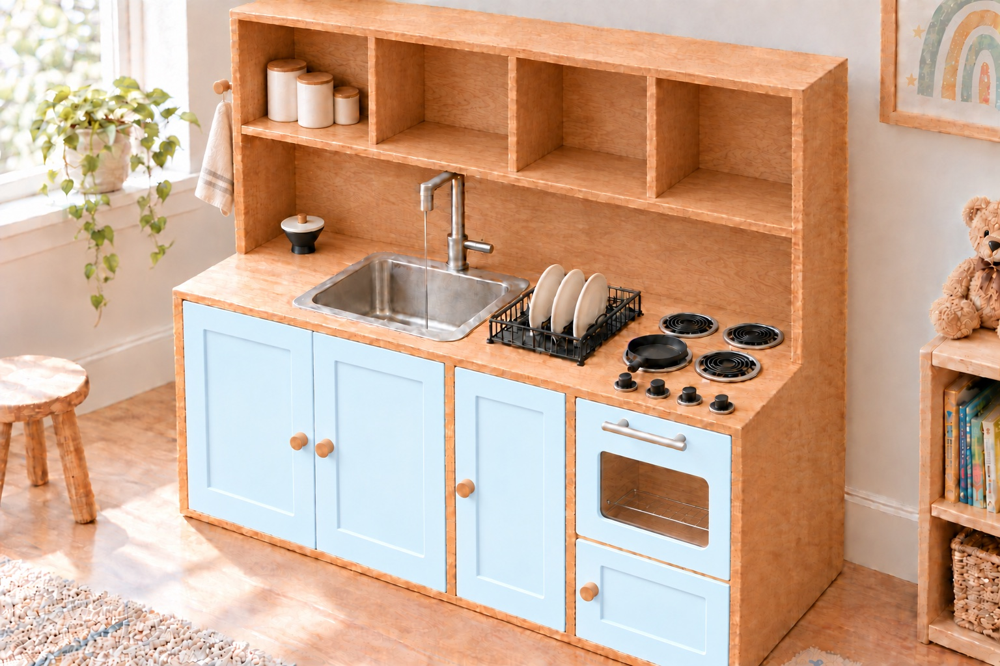
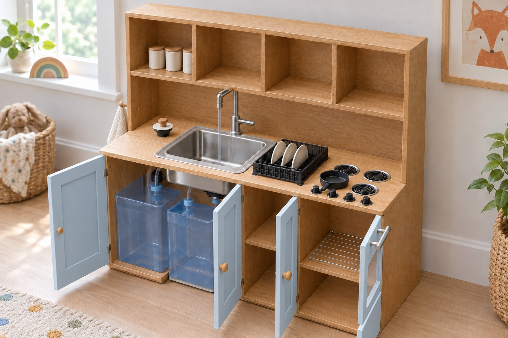
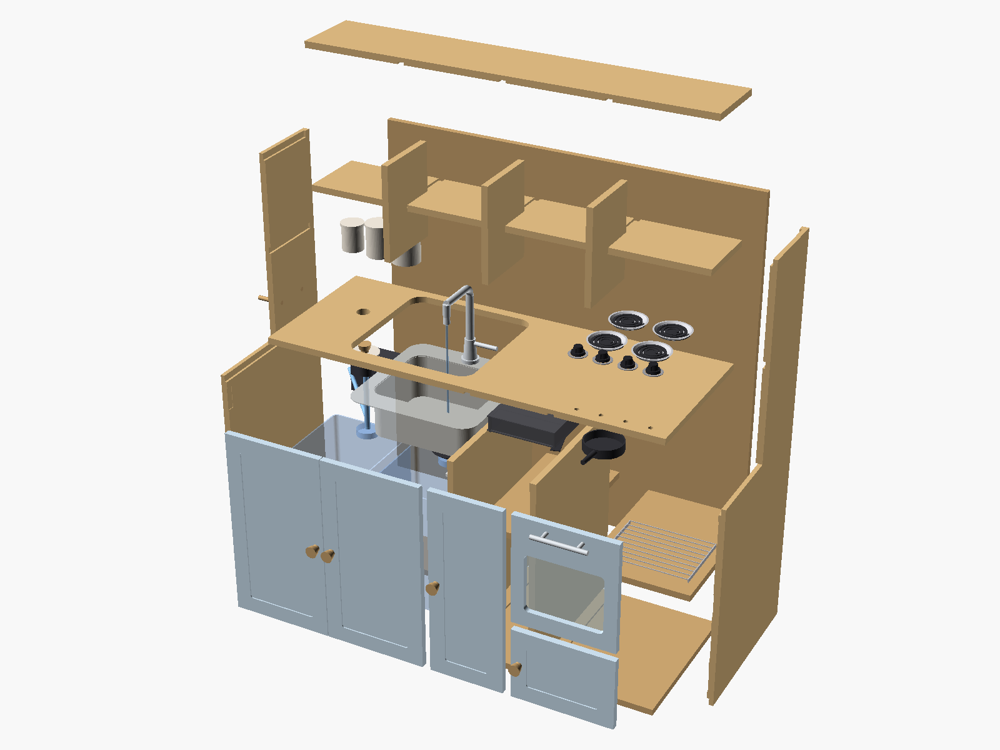
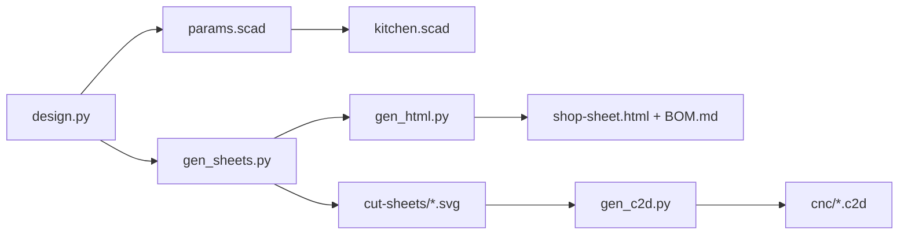

# Mini Kitchen

**A toddler play kitchen where the tap actually runs.** A real stainless sink, a real faucet and a 12 V pump fed from a
jug under the counter, plus an oven with a real window, four burners and knobs that turn. CNC-cut from red oak
plywood, with the cut list, cut sheets, CNC toolpaths and shop sheet all generated from one Python file.



<p align="center"><sub>Rendered from the CAD model.</sub></p>

|           |                                                                            |
| --------- | -------------------------------------------------------------------------- |
| 📐 Size   | 45 7/8 W × 18 D × 45 H in, counter at 23 in                                |
| 🪵 Stock  | Five 48 × 48 in panels of 3/4 in red oak plywood (measured 0.715–0.725 in) |
| 🛠️ CNC    | 19 parts, one 1/4 in downcut bit for everything, dado joinery              |
| 🖨️ Print  | 52 parts, no supports                                                      |
| 💧 Water  | 2 jugs, a 12 V demand pump, 2 float switches                               |
| 🧾 Budget | $824.57 as built, every line itemised in [`BOM.md`](BOM.md)                |

## ✨ Highlights

- **Water that really runs.** An Elkay 15 in drop-in bar sink and a single-handle bar faucet. Open the tap and the
  pump's pressure switch kicks in; close it and the pump stops. The aerator is set to 0.5 GPM so the sink never fills
  faster than it drains.
- **Clean jug in, dirty jug out.** The pump drinks from a 5 gal jug under the sink through a printed pickup foot; the
  sink drains through a basket strainer and a printed funnel into a second jug. The dirty jug stands in a notch in the
  floor panel, so it slides straight out the front to be emptied.
- **It stops itself.** Two side-mount float switches in series on a relay coil cut the pump when the clean jug is empty
  or the dirty jug is full. Every wire joint lives in a printed wiring box with labelled slots for lever
  connectors, so there is no crimping.
- **She refills it herself.** A printed, lidded fill port in the counter drains straight into the clean jug, so a small
  pitcher is all it takes.
- **An oven with a window.** A stock 8 × 10 in sheet of 1/8 in acrylic drops uncut into a CNC pocket on the oven
  door, held by four printed clips, with a stainless bar pull and a wire rack inside. A warming drawer sits below.
- **A stove that stays cold.** Four printed coil burners in drip pans, and four printed knobs with a captured 8-32 nut
  that turn on their own axle. Nothing ever heats up.
- **Built for a two-year-old.** Counter at 23 in, four open compartments at eye level, pale blue Shaker doors, rounded
  corners, two oak pegs for an apron and a towel, and an anti-tip strap to the wall.

## 📸 Gallery

<table>
  <tr>
    <td width="50%"><br><sub>Every door open: jugs and pump under the sink, oven rack, warming drawer.</sub></td>
    <td width="50%"><br><sub>Exploded view from <code>kitchen.scad</code>, bought parts ghosted in.</sub></td>
  </tr>
  <tr>
    <td width="50%"><br><sub>Every coupler from the clean jug to the faucet.</sub></td>
    <td width="50%"><br><sub>12 V supply, relay, pump and both floats in series.</sub></td>
  </tr>
</table>

## 📦 What's in the repo

| Path                                                   | What it is                                                                                                                                                  |
| ------------------------------------------------------ | ----------------------------------------------------------------------------------------------------------------------------------------------------------- |
| [`shop-sheet.pdf`](shop-sheet.pdf)                     | **Start here.** The whole build: budget, cut list, sheet layouts, toolpath order, printed parts, wiring, plumbing, assembly, finish, checklist.             |
| [`shop-sheet.html`](shop-sheet.html), `shop-sheet.css` | The same shop sheet as a web page (Letter print styles included).                                                                                           |
| [`BOM.md`](BOM.md)                                     | Bill of materials with store links and prices paid, plus the printed-parts list.                                                                            |
| [`design.py`](design.py)                               | **The single source of every number.** Stock thickness, bay widths, dado fit, hinge recesses, jug and sink positions.                                       |
| [`kitchen.scad`](kitchen.scad)                         | OpenSCAD model of the cabinet, in inches. `part = "assembly"`, `"exploded"`, or one panel at a time.                                                        |
| [`printed.scad`](printed.scad)                         | OpenSCAD model of every printed part, in millimetres. Pick one with `part = "..."`.                                                                         |
| [`wire_box_wired.scad`](wire_box_wired.scad)           | The wiring box with its connectors in place, for the shop-sheet figure.                                                                                     |
| `params.scad`                                          | Generated by `design.py` and included by `kitchen.scad`. Don't edit it by hand.                                                                             |
| [`cut-sheets/`](cut-sheets)                            | Five 1:1 SVG cut sheets (48 × 48 in), layered by operation, for any CAM software.                                                                           |
| [`cnc/`](cnc)                                          | Carbide Create `.c2d` files, one per sheet, toolpaths already set for the 1/4 in downcut bit. `template.c2d` supplies the stock, machine and feed settings. |
| [`stl/`](stl)                                          | Every printed part as an STL, plus `hinge-shims/` (0.4 to 1.6 mm) for a hinge recess cut too deep.                                                          |
| [`plates/`](plates)                                    | Two ready-made 3MF print plates: the black stove parts and the silver drip pans.                                                                            |
| `gen_*.py`                                             | Generators for the cut sheets, shop sheet, BOM, Carbide Create files and the float, plumbing and wiring figures.                                            |
| `render.sh`, `render_parts.sh`                         | Re-render the OpenSCAD previews used by the shop sheet.                                                                                                     |
| `previews/`, `*.png`, `*.jpg`, `*.svg` (root)          | Renders, previews and figures.                                                                                                                              |

## 🔁 Change it and regenerate

Everything downstream comes from `design.py`, so one edit ripples through the model, the cut sheets, the toolpaths and
the shop sheet.



The scripts use only the Python 3 standard library, so there is nothing to install. Run them from the repo root, in
this order:

```bash
python3 design.py params.scad && python3 gen_sheets.py && python3 gen_html.py && python3 gen_c2d.py
```

The figures have their own scripts:

```bash
python3 gen_float_fig.py && python3 gen_plumbing_fig.py && python3 gen_wiring_fig.py
```

To re-render the OpenSCAD previews (macOS, expects OpenSCAD 2021.01 in `/Applications`):

```bash
./render.sh        # cabinet views, exploded view, burner, toys, wired box
./render_parts.sh  # one PNG per printed part
```

To print a part, open `printed.scad`, set `part` (and `size` for the canisters and lids) and export to STL; the
header of the file lists every part with its quantity and print orientation.

> [!IMPORTANT]
> Measure your plywood with calipers before you cut. Set `T` and `T_MAX` in `design.py`, regenerate, cut a test dado
> on an offcut, and run the Carbide Create simulation before any sheet goes on the machine.

## 🪚 How it goes together

The shop sheet has the full, step-by-step version. In short:

1. **Cut.** Five sheets (`S1` sides, `S2` back, `S3` counter, bottom and top, `S4` dividers and shelves, `S5` doors
   and upper shelf), in a fixed order: dados and rabbets, hinge recesses, Shaker panels and the window pocket, holes,
   inside profiles, then outside profiles on tabs.
2. **Print** the 52 parts: burners, knobs, toys, the fill port, pickup foot, drain funnel, window clips and the wiring
   box.
3. **Dry fit, then glue and screw.** Every panel sits 1/4 in into a dado or rabbet in its neighbour, glued with
   Titebond III and clamped by three #8 × 1 1/4 in screws per joint. Heads on the outside faces and the top get oak
   plugs.
4. **Band and finish.** Oak edge banding on every visible edge, three or more coats of poly on the oak, primer and two
   coats of pale blue enamel on the five doors, and a week's cure before any water.
5. **Hang the doors** on butt hinges seated in CNC recesses, with a 3/32 in reveal.
6. **Plumb and wire.** Sink, faucet, pump, jugs, floats, tubing and the wiring box.
7. **Strap it to a stud.** Then let the kid loose.

## 🧾 Materials

The full list, with links, quantities and notes, is in [`BOM.md`](BOM.md). As built:

| Category               | Subtotal (USD) |
| ---------------------- | -------------: |
| Wood and finish        |         351.83 |
| Fasteners              |          30.82 |
| Doors and hardware     |          23.65 |
| Sink and faucet        |         155.72 |
| Water                  |         101.73 |
| Electrical             |          71.12 |
| Oven, stove and dishes |          52.18 |
| Safety                 |          11.58 |
| Tax (Amazon orders)    |          25.94 |
| **Total**              |     **824.57** |

Amazon prices are what was paid in October 2026; Home Depot prices are before tax. Polyurethane, sandpaper, PTFE tape
and filament are assumed on hand.

## ⚠️ Safety

- **Strap it to the wall.** A 45 in hutch with a toddler on the oven door is a ladder; the strap in the BOM runs from the
  back of the cabinet to a wall stud.
- **Low voltage only.** The pump runs on a 12 V supply that stays outside the cabinet, and its plug is the adult off
  switch.
- **Play water, not drinking water.** Tip the dirty jug out after play and leave the sink doors open to dry.
- **Nothing heats up.** The burners and knobs are printed plastic.
